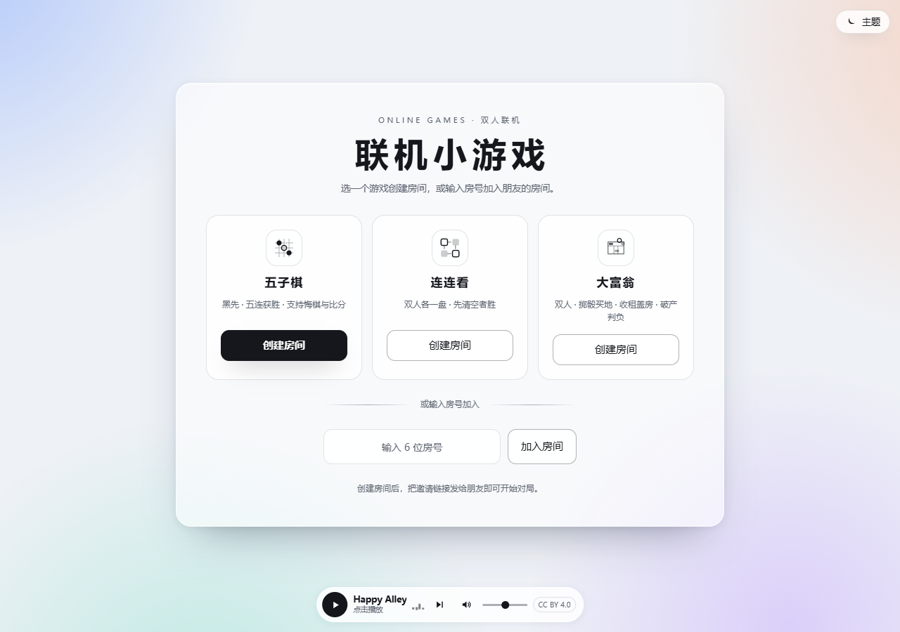
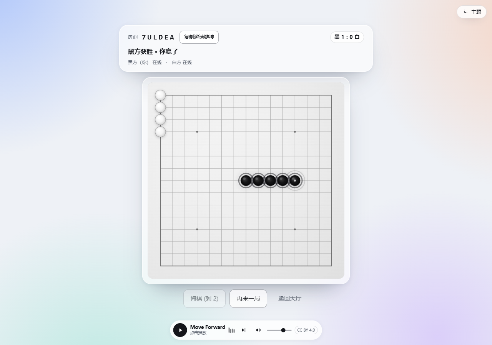
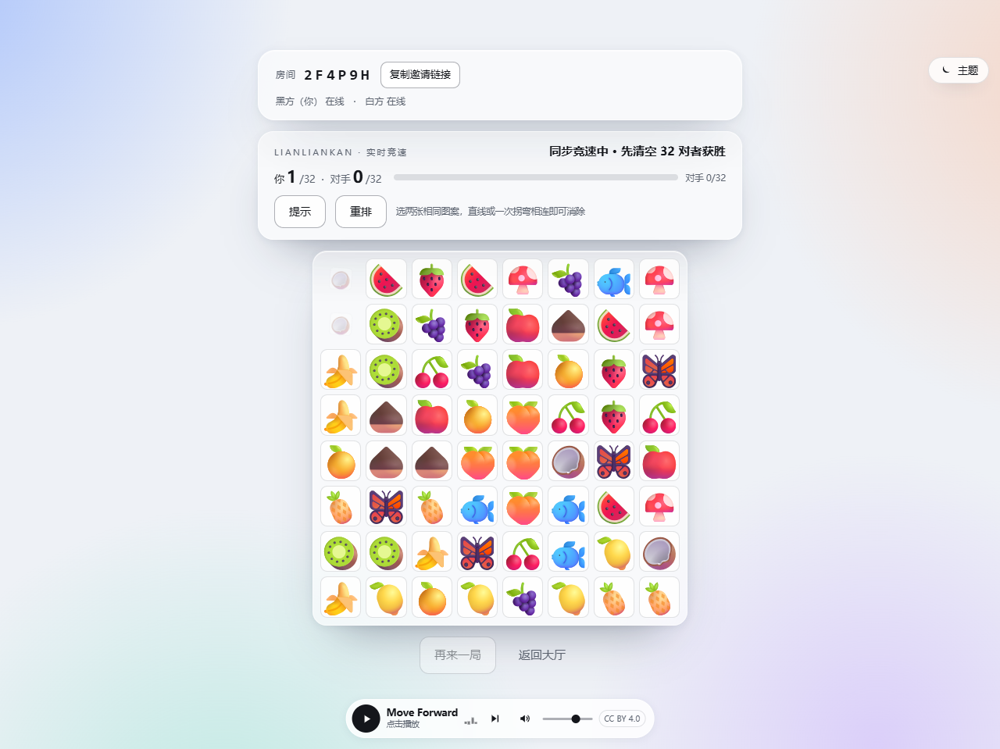
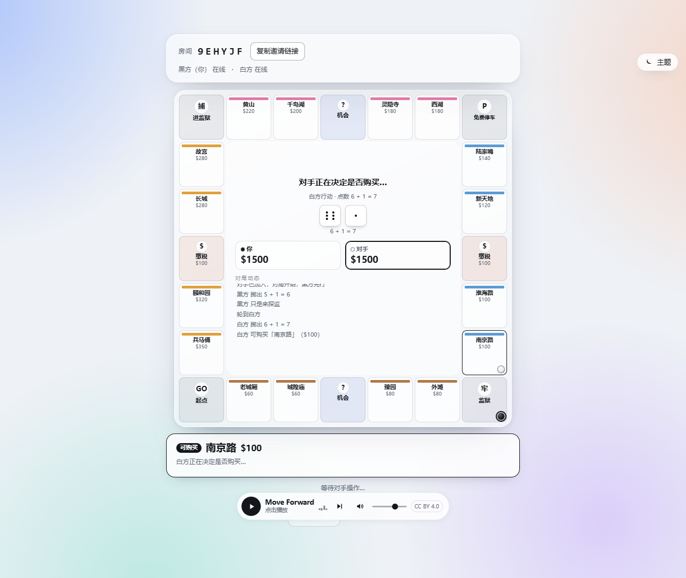
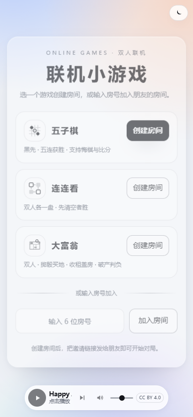
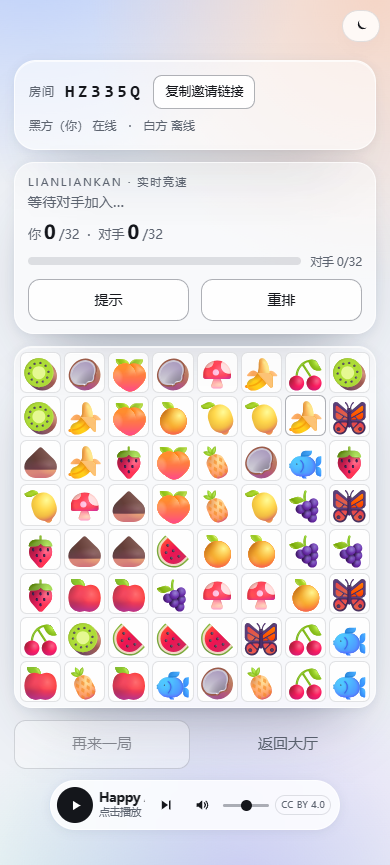

# 联机小游戏 · Online Games

一个极简风格的**双人联机小游戏平台**，浏览器打开即可与朋友对战。目前包含三款游戏：

- **五子棋**：15×15 棋盘，黑先，五连获胜；支持**悔棋**（请求对方同意，每人每局 3 次）与**房间内跨局比分**
- **连连看**：双人各自一块 8×8 棋盘竞速，先清空 32 对者胜；棋盘保证有解，支持提示与重排
- **大富翁**：双人完整版——掷骰移动、买地收租、盖房/旅馆、抵押赎回、监狱与出狱卡、机会卡、破产判负

- 在线地址：<https://wkeeli.cn/gomoku/>
- 通用功能：创建 / 加入房间（6 位房号）、邀请链接、观战、再来一局、断线重连、明暗主题切换
- 音乐：可选的免费版权背景音乐（外链 [Incompetech](https://incompetech.com) · Kevin MacLeod · CC BY 4.0），默认关闭、点按钮播放；曲目清单见 `web/playlist.json`，署名见 `web/MUSIC-CREDITS.md`
- 视觉：黑白灰极简 UI + 低饱和彩色氛围背景、棋盘质感、落子/消除动画、胜利高光

## 界面

| 平台首页 | 五子棋（悔棋 / 比分） | 连连看（双人竞速） | 大富翁 |
| --- | --- | --- | --- |
|  |  |  |  |

| 手机端首页 | 手机端连连看 |
| --- | --- |
|  |  |

## 游戏规则（大富翁）

- 24 格环形棋盘：起点、监狱（探监）、免费停车、进监狱 + 16 块地产（4 组 ×4）+ 2 张机会 + 2 格税。
- 初始现金 $1500；经过/落在起点领 $200；掷出双数可再掷一次，连续三次双数进监狱。
- 无主地产可购买或放弃；他人地产付租金（整组持有且无房时基础租金×2，房屋 1–4 栋与旅馆租金递增）；抵押中的地产免租。
- 拥有整组后可均匀盖房（最多 4 栋房屋 + 1 座旅馆）；地产可按 50% 抵押、按 110% 赎回。
- 监狱：缴纳 $50 保释或掷双数出狱；连续 3 次未掷出双数自动缴保释金出狱；出狱卡可免费使用。
- 机会卡：分红、缴税、回到起点、进监狱、出狱卡、房屋维修、彩票、罚单。
- 现金不足时自动卖房/抵押筹钱；仍不足则破产，对手获胜。

## 技术栈

| 层 | 实现 |
| --- | --- |
| 前端 | 原生 HTML / CSS / JavaScript，Canvas 绘制五子棋棋盘，无构建、无第三方依赖 |
| 后端 | Python 3 标准库 `http.server`，SSE（Server-Sent Events）实时推送，内存房间状态，零第三方依赖 |
| 部署 | systemd 托管 Python 服务，Caddy 子路径反向代理 |

服务端是唯一的裁判：房间、落子合法性、连连看路径判定、大富翁掷骰/交易/破产，胜负与比分全部在服务端完成，客户端只负责渲染。

## 本地运行

```bash
python server.py                 # 默认 0.0.0.0:8086
python server.py --port 9000     # 指定端口
```

打开 <http://127.0.0.1:8086/>，选择游戏创建房间；两个浏览器窗口分别创建 / 加入同一房间即可对战。

## 测试

```bash
python tests/test_api.py --port 8086    # 需先启动服务
python tests/test_e2e.py --port 8086    # 浏览器 E2E（Playwright + Edge）
python tests/test_monopoly.py           # 大富翁核心逻辑单元测试（无需启动服务）
```

- API 冒烟：**112 项断言**（三款游戏建房/加入/观战；五子棋轮次、五连、悔棋、比分；连连看提示/配对/胜负；
  大富翁掷骰/买地/回合/接口隔离；错误码与旧客户端兼容等）
- 浏览器 E2E：**51 项断言**（平台首页三卡、双人实时对战、悔棋、比分、刷新保座、明暗主题、音乐、
  连连看双棋盘/提示/进度、大富翁建棋盘/掷骰/买地/日志、移动端、控制台无报错）
- 大富翁单元测试：**63 项断言**（移动/过起点/租金/盖房/抵押/监狱/机会卡/破产/重开/state 序列化）

## 目录结构

```
server.py              后端服务（HTTP API + SSE + 静态文件，多游戏房间）
web/                   前端页面（index.html / style.css / app.js / llk.js / monopoly.js / ...）
web/playlist.json      背景音乐清单（外链）
web/MUSIC-CREDITS.md   背景音乐署名与许可证说明
tests/test_api.py      API 冒烟测试
tests/test_e2e.py      浏览器端到端测试
tests/test_monopoly.py 大富翁核心逻辑单元测试
deploy/                部署配置（systemd unit、Caddy 路由片段、部署说明）
```

## HTTP / SSE 接口

| 方法 | 路径 | 说明 |
| --- | --- | --- |
| POST | `/api/room` | 创建房间 `{game}`：`gomoku` / `lianliankan` / `monopoly`，返回房号与 token（执黑） |
| POST | `/api/join` | 加入房间 `{roomId, token?}`，返回颜色（1 黑 / 2 白 / 0 观战）与 `game` |
| POST | `/api/move` | 五子棋落子 `{roomId, token, x, y}` |
| POST | `/api/undo` | 五子棋悔棋 `{roomId, token, action}`：`request` / `accept` / `reject` / `cancel` |
| POST | `/api/match` | 连连看配对 `{roomId, token, x1, y1, x2, y2}` |
| POST | `/api/hint` | 连连看提示，返回一对可消坐标（无解时自动重排） |
| POST | `/api/shuffle` | 连连看重排剩余图案 |
| POST | `/api/roll` | 大富翁掷骰 `{roomId, token}`（含监狱判定） |
| POST | `/api/buy` | 大富翁买地/放弃 `{roomId, token, action:"buy"|"pass"}` |
| POST | `/api/jail` | 大富翁保释/出狱卡 `{roomId, token, action:"pay"|"card"}` |
| POST | `/api/build` | 大富翁盖房 `{roomId, token, tile}` |
| POST | `/api/mortgage` | 大富翁抵押/赎回 `{roomId, token, tile, action:"mortgage"|"unmortgage"}` |
| POST | `/api/endturn` | 大富翁结束回合 `{roomId, token}` |
| POST | `/api/restart` | 切换「再来一局」就绪状态，双方就绪后重开（五子棋比分保留） |
| GET | `/api/stream?room=&token=` | SSE 状态流，事件名 `state`，含 `game` 及对应棋局字段 |

部署在子路径（如 `/gomoku/`）时，前端一律使用相对路径，后端无需感知前缀。

## 部署

见 [deploy/README.md](deploy/README.md)。

## 已知限制

- 公开访问，无账号体系与限流；若被刷房间，可在应用层加房间/连接上限。
- 房间状态保存在内存中，服务重启即丢局；房间 2 小时无活动自动回收。
- 断线检测在约 1 秒内发现，再经 3 秒去抖后通知对手（约 4 秒）；SSE 另每 15 秒发一次心跳保活。
- SSE 的玩家 token 通过查询参数传递，会进入反向代理/服务访问日志（公开小游戏，风险可接受）。
- 背景音乐为外部曲库直链（incompetech.com，CC BY 4.0）：源站不可达或较慢时自动降级为无声/缓冲；曲目不缓存（源站 `no-store`）。
- 五子棋悔棋需对方同意，每人每局 3 次，终局后不可悔棋；比分为房间内累计、离开房间即清空。
- 连连看棋盘在生成时保证有解；玩家自行消出死局时可点「重排」或「提示」自动重排剩余图案。
- 大富翁为双人简化完整版：无拍卖/玩家间交易/卖回银行；破产时按「先卖房再抵押、仍不足判负」自动清算。
- 五子棋采用自由规则：5 子及以上连珠即胜，无禁手。

## License

[MIT](LICENSE)
